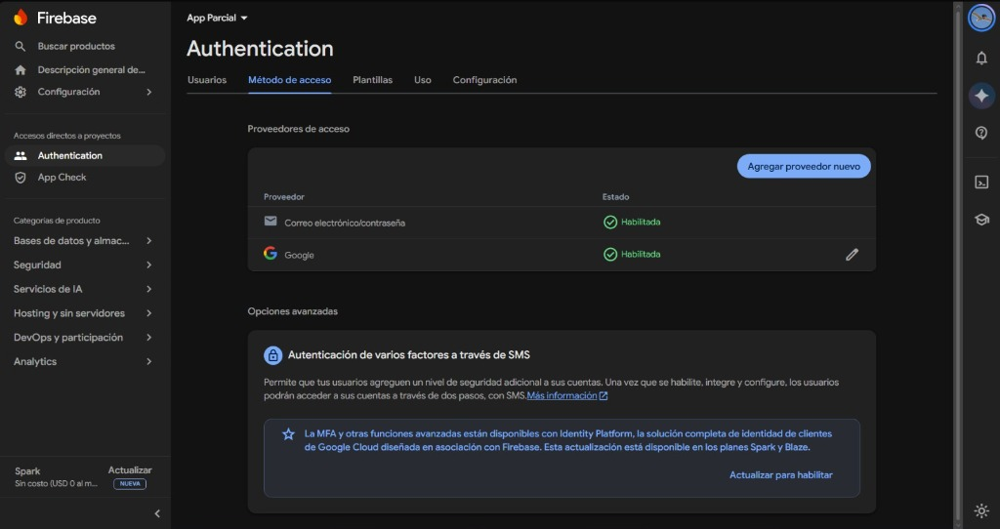
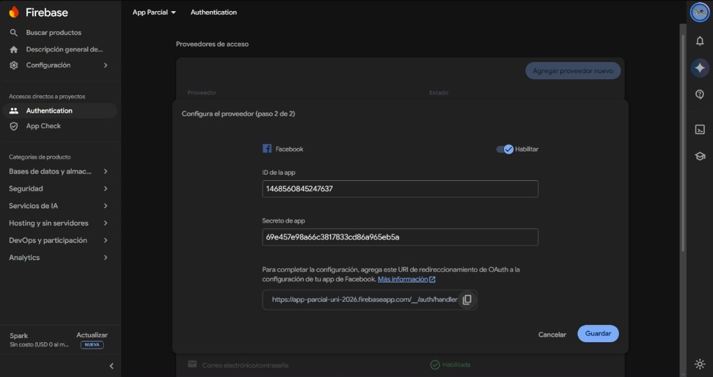
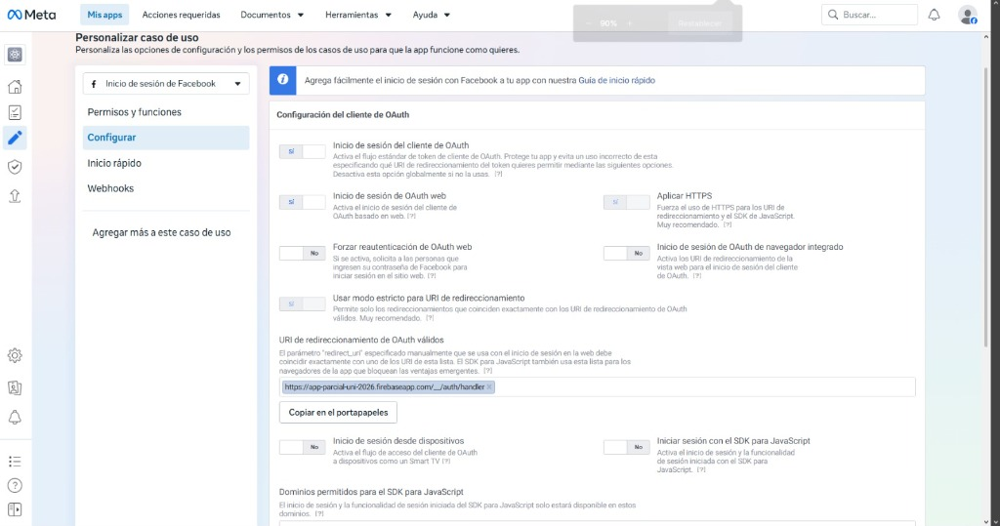
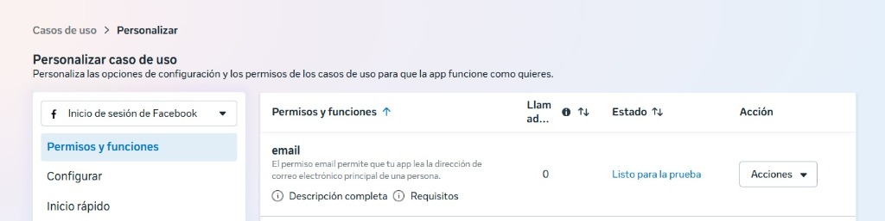
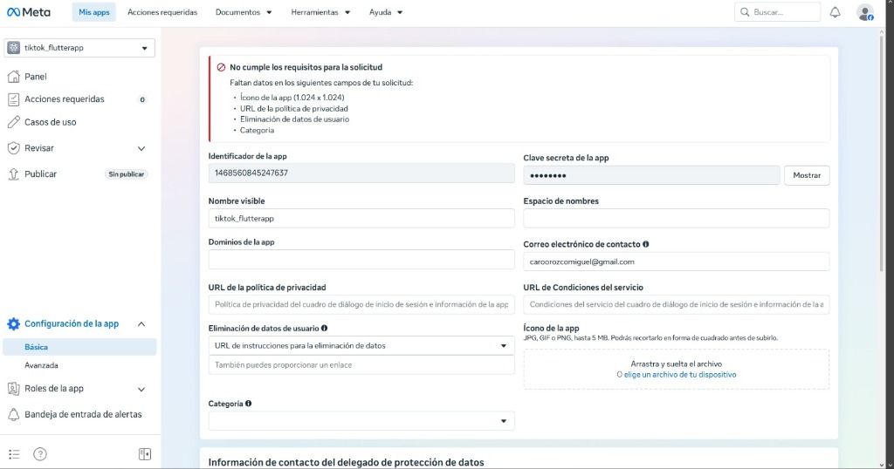

App Parcial


Video de Evidencia en Funcionamiento

(https://drive.google.com/file/d/19tLs0zrtd5RM8jaSnDdUZjB_E2cWTU0Z/view?usp=sharing)


## 📂 Estructura del Proyecto

El proyecto sigue una arquitectura limpia inspirada en los proyectos base del curso:

```text
app_parcial/
├── assets/
│   ├── icons/
│   │   └── google.png           # Logo oficial de Google
│   └── videos/
│       ├── video1.mp4           # Video local 1
│       ├── video2.mp4           # Video local 2
│       ├── video3.mp4           # Video local 3
│       └── video4.mp4           # Video local 4
├── evidencias/                  # Capturas de configuración
│   ├── 01_meta_oauth_redirect.jpg
│   ├── 02_meta_app_settings.jpg
│   ├── 03_firebase_facebook_setup.jpg
│   ├── 04_meta_email_permission.jpg
│   └── 05_firebase_authentication_providers.jpg
└── lib/
    ├── config/
    │   └── router/
    │       └── app_router.dart  # Configuración de GoRouter y redirección reactiva
    ├── models/
    │   └── video_item.dart      # Modelo de datos y lista de videos locales
    ├── presentation/
    │   └── screens/
    │       ├── feed/
    │       │   ├── feed_screen.dart       # Contenedor vertical (PageView) y Header de logout
    │       │   └── feed_video_item.dart   # Reproductor, detector de toques y overlays
    │       ├── login/
    │       │   └── login_screen.dart      # Formulario de login y accesos Google/Facebook
    │       └── register/
    │           └── register_screen.dart   # Formulario de registro con validaciones
    ├── services/
    │   └── auth_service.dart    # Métodos de autenticación Firebase, Google, Facebook y Logout
    ├── firebase_options.dart    # Configuración autogenerada por FlutterFire CLI
    └── main.dart                # Punto de entrada de la aplicación
```

---

## 📸 Evidencias de Configuración

### 1. Proveedores habilitados en Firebase Authentication
Configuración de Correo/Contraseña, Google y Facebook habilitados:


### 2. Vinculación de Facebook en Firebase Console
ID de la App y Clave Secreta de Meta vinculadas con el URI de redireccionamiento de OAuth:


### 3. Configuración de Meta for Developers (OAuth)
URIs de redireccionamiento de OAuth válidos autorizados en la plataforma de Meta:


### 4. Permisos de Facebook Login
Permiso de `email` configurado y verificado en Meta:


### 5. Datos básicos de la aplicación en Meta
Credenciales e identificador de la aplicación registrada:



